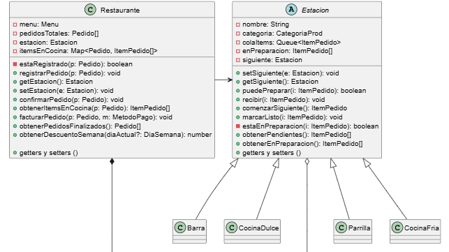

# 🍽️ Sistema de Gestión de Pedidos - "Fogón del Barrio"

Trabajo Práctico — Programación II - Grupo 9  
**Tecnologías:** TypeScript, Jest (Pruebas Unitarias)

---

## 📌 Descripción del Proyecto

"Fogón del Barrio" es un restaurante tradicional que operaba mediante toma de pedidos manual en papel. Este proyecto consiste en el desarrollo de un sistema informático robusto en **TypeScript** para digitalizar de punta a punta la gestión del negocio: desde la creación de pedidos en sus distintas modalidades, su preparación independiente en estaciones de cocina distribuidas, hasta el control de stock, aplicación de beneficios/descuentos y facturación final.

---

## 🚀 Características Principales (Requerimientos Funcionales)

1. **Modalidades de Pedido:** Soporta pedidos en **Salón** (asociados a una mesa), para **Retirar** (con horario pactado) y con **Envío Propio** (con dirección y costo de envío), diseñado de forma extensible para incorporar nuevas modalidades a futuro.
2. **Gestión de Menú y Combos:** Administración de productos individuales por categorías y combos flexibles (con descuentos porcentuales o precios fijos cerrados).
3. **Construcción y Corrección de Pedidos:** Permite agregar/quitar ítems de a uno mientras el pedido está "en construcción", soportando operaciones de **deshacer (undo)** para corregir errores rápidamente antes de confirmarlo.
4. **Distribución a Estaciones de Cocina:** Al confirmar un pedido, sus ítems se derivan de forma automática e independiente a las estaciones correspondientes (parrilla, cocina fría, barra, pastelería, etc.) respetando el orden de llegada.
5. **Control de Estados y Bloqueos:** 
   * Los ítems transitan por los estados: `pendiente` $\rightarrow$ `en preparación` $\rightarrow$ `listo`.
   * Un ítem en estado `en preparación` no puede ser modificado ni cancelado.
   * Ningún pedido puede facturarse si posee ítems pendientes o en preparación.
6. **Medios de Pago y Descuentos Dinámicos:** Cálculo de subtotales y totales aplicando el medio de pago elegido (Efectivo, Tarjetas, Billetera virtual) y seleccionando automáticamente el descuento más beneficioso para el cliente entre múltiples opciones aplicables (por pago en efectivo o días especiales).
7. **Historial de Pedidos:** Consulta permanente del historial de pedidos finalizados con el detalle de lo cobrado.

---

## 🛠️ Estructura del Repositorio y Arquitectura

El diseño interno de clases prioriza principios SOLID, alta cohesión y bajo acoplamiento para garantizar la escalabilidad (creación de nuevas estaciones o modalidades sin modificar la lógica existente).

* `src/` - Contiene el código fuente del dominio y la lógica de negocio.
* `tests/` - Pruebas unitarias desarrolladas con Jest.

---

## 📑 Utilización de Patrones

# Composite - Item/Menú 

El diseño contempla la utilización de patrones como por ejemplo el Patrón Estructural **Composite** donde se observa la jerarquía de productos y combo, en las clases asociadas a Item, Menu.
Permite tratar de manera uniforme tanto a los elementos individuales -hojas/Leaves- *Producto* como a los contenedores complejos -kits/menús- *Combo* que agrupan a otros elementos.
El Menú puede almacenar colecciones de elementos y trabajar con ellos a través de una interfaz, permitiendo calcular precios, recorrer el árbol de forma recursiva sin preguntar constantemente por el tipo de objeto.

# Chain Of Responsability - Estaciones de cocina

1. Nombre y categoria: Chain of Responsability, categoria de comportamiento

2. Problema que resuelve: En el requerimiento funcional 4 se pide que cuando se confirme un pedido, cada uno de sus items se distribuyan a las estaciones que correspondan. Tambien el requerimiento funcional 5 que indica que se debe de agregar que se procesen los items en el orden que le llegaron. Con este patron el **Restaurante** le entrega cada item a la primera estacion de la "Cadena" y cada estacion decide si lo prepara o si se lo pasa a la siguiente

3. Participantes: 
Handler / BaseHandler: La clase **Estacion** siendo la responsable de proveer el atributo siguiente y los meteodos setSiguiente,recibir y puedePreparar

ConcreteHandlers: Son todas las subclases de la Estacion (Parrilla,CocinaFria,etc.)

4. Diagrama:

5. Justificacion:

Cumplimos el principio SOLID de Abierto y Cerrado ya que cada estacion nueva que se agregue forma parte de la cadena del chain of responsability

Cumplimos el principio SOLID de Responsabilidad Unica ya que cada estacion decide por si misma que puede preparar

Costos/limitacion: 

Un item puede llegar al final de la cadena de estaciones sin que nadie lo maneje.

---

## 🧪 Pruebas Unitarias y Calidad de Código

El proyecto cuenta con una cobertura de pruebas unitarias superior al **80%**, garantizando el correcto funcionamiento de cada regla de negocio.

Para ejecutar las pruebas y verificar la cobertura, utiliza los siguientes comandos:

# Instalar dependencias
npm install

# Ejecutar pruebas y verificar porcentaje de cobertura
npm run test

# Compilar Solución
npm run build
